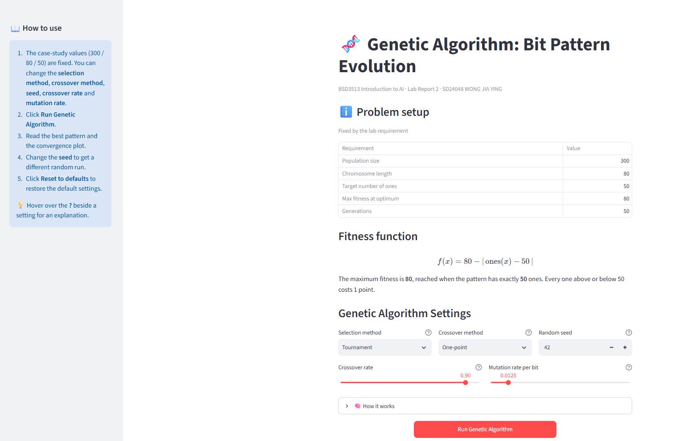
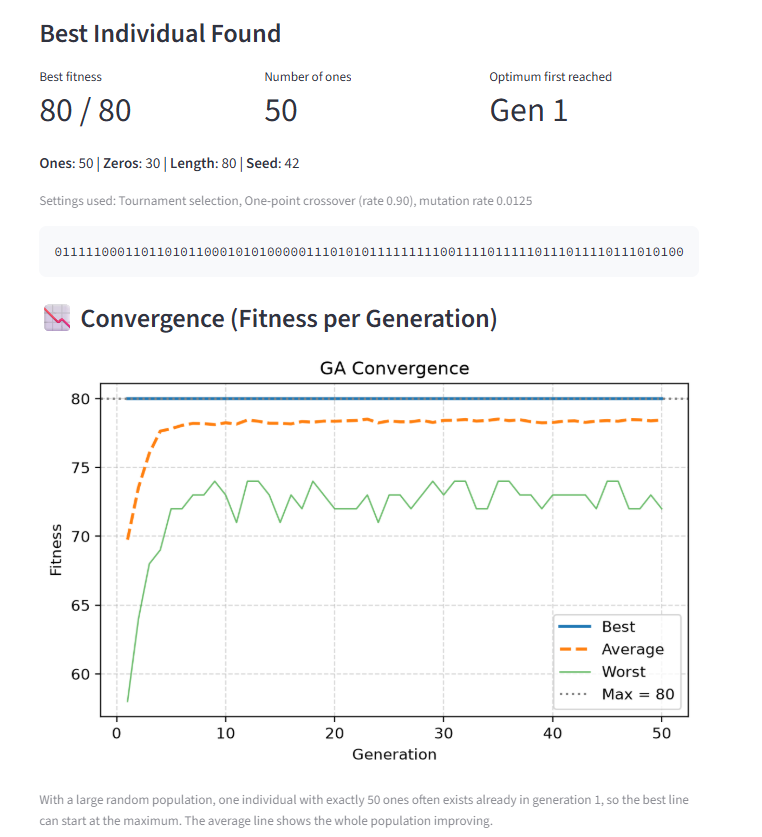

# 🧬 Genetic Algorithm: Bit Pattern Evolution

**BSD3513 Introduction to Artificial Intelligence · Lab Report 2**

**SD24048 WONG JIA YING**

🌐 **Live App:** [https://lab-report-2-pqeussphud9jfdbura28ye.streamlit.app/](https://lab-report-2-pqeussphud9jfdbura28ye.streamlit.app/)

💻 **Source Code:** [https://github.com/wongjiaying-wjy/Lab-Report-2](https://github.com/wongjiaying-wjy/Lab-Report-2)



## About

An interactive Streamlit application that uses a genetic algorithm to evolve a bit pattern with predefined parameters from the case study: a population of **300** individuals, each **80** bits long, evolved for **50** generations. The fitness function returns its maximum value of **80** when the number of ones equals **50**. The app shows the best pattern found and how the fitness changes over the generations.

## Default Variables

**Fixed by the lab requirement (cannot be changed in the app)**

| Variable | Value |
|---|---|
| Population size | 300 |
| Chromosome length | 80 |
| Target number of ones | 50 |
| Max fitness at optimum | 80 |
| Generations | 50 |

**Adjustable settings (can be changed in the app)**

| Setting | Default | Options / Range |
|---|---|---|
| Selection method | Tournament | Tournament, Roulette wheel, Rank-based |
| Crossover method | One-point | One-point, Two-point, Uniform |
| Random seed | 42 | Any whole number from 0 |
| Crossover rate | 0.90 | 0.00 to 1.00 |
| Mutation rate per bit | 0.0125 (1/80) | 0.0000 to 0.1000 |

**Fixed GA settings**

| Setting | Value |
|---|---|
| Tournament size | 3 |
| Elitism | 2 best individuals copied unchanged |

## Key Features

- Case-study requirements (300 / 80 / 50) shown in a fixed table, so they cannot be changed by mistake.
- Adjustable selection method, crossover method, random seed, crossover rate and mutation rate, each with a help tooltip.
- "How to use" guide and "How it works" explanation above the Run button.
- Fitness function shown as a formula.
- Result summary with the best bit pattern, its number of ones and fitness, and the first generation that reached the maximum.
- Convergence plot showing the best, average and worst fitness for every generation.
- Per-generation statistics table.
- Reset button to restore the default settings.

## Screenshots

**Results and convergence plot**



## How to Run

```bash
pip install -r requirements.txt
streamlit run SD24048_Lab2.py
```

The app usually opens at <http://localhost:8501>.

## How to Use the App

1. The case-study values (300 / 80 / 50) are fixed. You can change the selection method, crossover method, seed, crossover rate and mutation rate.
2. Click **Run Genetic Algorithm**.
3. Read the best pattern and the convergence plot.
4. Change the **seed** to get a different random run. The same seed always gives the same result.
5. Click **Reset to defaults** to restore the default settings.

## How the Genetic Algorithm Works

1. **Initialisation:** The algorithm randomly generates 300 individuals. Each individual consists of 80 bits containing either 0 or 1.
2. **Fitness evaluation:** The algorithm counts the number of ones in each individual. An individual receives the highest fitness score of 80 when it contains exactly 50 ones. Every one above or below 50 lowers the score by 1.
3. **Selection:** Parents are chosen using the selected method. With the default Tournament method, the algorithm randomly picks three individuals and chooses the one with the highest fitness score.
4. **Crossover:** Two selected parents exchange parts of their binary patterns to produce new individuals.
5. **Mutation:** Some bits are randomly flipped from 0 to 1 or from 1 to 0 to introduce variation.
6. **Elitism:** The two individuals with the highest fitness scores are kept for the next generation to prevent losing good solutions.
7. **Termination:** The algorithm repeats these steps for 50 generations and reports the individual with the highest fitness score.

## Repository Structure

```
Lab-Report-2/
├── SD24048_Lab2.py
├── requirements.txt
├── README.md
└── image/
```

## Built with

Python · Streamlit · NumPy · Matplotlib · pandas

## Complexity note

Each generation evaluates, selects, recombines and mutates *P* individuals of length *L*, so one run costs **O(G × P × L)** operations. For the case study this is 50 × 300 × 80 = 1,200,000 bit operations. The genetic algorithm is a heuristic: it does not guarantee the optimum, but with this simple fitness function it reaches 80 quickly.
