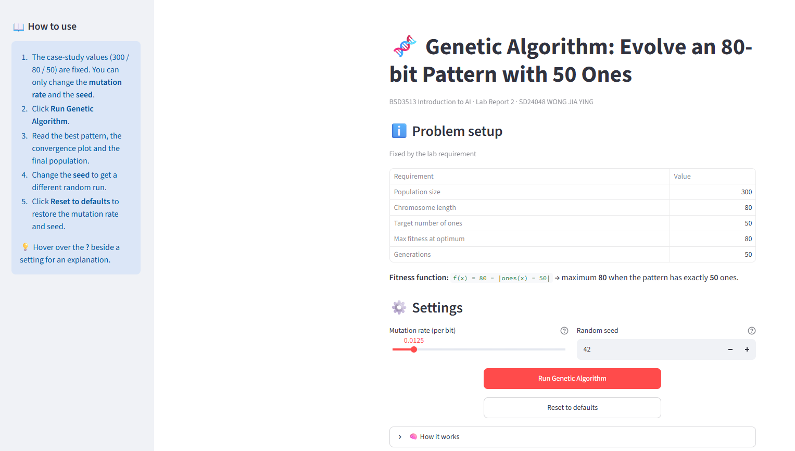

# 🧬 Genetic Algorithm Explorer: Evolving an 80-bit Pattern with 50 Ones

**BSD3513 Introduction to Artificial Intelligence · Lab Report 2**

**SD24048 WONG JIA YING**

🌐 **Live App:** [https://lab-report-2-pqeussphud9jfdbura28ye.streamlit.app/](https://lab-report-2-pqeussphud9jfdbura28ye.streamlit.app/)

💻 **Source Code:** [https://github.com/wongjiaying-wjy/Lab-Report-2](https://github.com/wongjiaying-wjy/Lab-Report-2)



## About

An interactive Streamlit application that uses a genetic algorithm to evolve a bit pattern with predefined parameters from the case study: a population of **300** individuals, each **80** bits long, evolved for **50** generations. The fitness function returns its maximum value of **80** when the number of ones equals **50**. The app shows the best pattern found, how the fitness changes over the generations, and how the population gathers around 50 ones.

## Key Features

- Case-study requirements (300 / 80 / 50) shown in a fixed table, so they cannot be changed by mistake.
- Adjustable **mutation rate** slider and **random seed** (default 42) for reproducible runs, each with a help tooltip.
- Sidebar "How to use" guide.
- Result summary with the best bit pattern, its number of ones and fitness, and the first generation that reached the maximum.
- Convergence plot showing the best, average and worst fitness for every generation.
- Histogram of the number of ones in the final population.
- Per-generation statistics table.
- Case-study requirement check table.
- Reset button to restore the default mutation rate and seed.

## Screenshots

| Problem setup and settings | Results |
|---|---|
|  |  |

**Convergence plot and requirement check**


## How to Run

```bash
pip install -r requirements.txt
streamlit run SD24048_Lab2.py
```

The app usually opens at <http://localhost:8501>.

## How to Use the App

1. The case-study values (300 / 80 / 50) are fixed. Only the **mutation rate** and the **seed** can be changed.
2. Click **Run Genetic Algorithm**.
3. Read the best pattern, the convergence plot and the final population.
4. Change the **seed** to get a different random run. The same seed always gives the same result.
5. Click **Reset to defaults** to restore the mutation rate and seed.

## How the Genetic Algorithm Works

1. Create 300 random 80-bit chromosomes.
2. Score every chromosome with `fitness = 80 - |ones - 50|`.
3. **Selection:** a tournament of 3 random individuals picks each parent.
4. **Crossover:** single-point crossover with probability 0.9.
5. **Mutation:** each bit flips with probability 0.0125 (1/80) by default.
6. **Elitism:** the 2 best individuals are copied unchanged into the next generation.
7. Repeat for 50 generations and report the best pattern.

## Code Overview

| Function | Purpose |
|---|---|
| `fitness()` | Scores each chromosome; maximum (80) when it has 50 ones. |
| `init_population()` | Creates the random starting population. |
| `tournament_selection()` | Picks the fittest of 3 random individuals as a parent. |
| `single_point_crossover()` | Swaps the tails of two parents after one random cut. |
| `mutate()` | Flips each bit with the mutation probability. |
| `evolve()` | Runs selection, crossover, mutation and elitism for all generations and records the statistics. |
| `reset_defaults()` | Restores the default mutation rate and seed. |

## Repository Structure

```
Lab-Report-2/
├── SD24048_Lab2.py
├── requirements.txt
├── README.md
└── image/
```

## Built with

Python · Streamlit · NumPy · Matplotlib · pandas

## Complexity note

Each generation evaluates, selects, recombines and mutates *P* individuals of length *L*, so one run costs **O(G × P × L)** operations. For the case study this is 50 × 300 × 80 = 1,200,000 bit operations. The genetic algorithm is a heuristic: it does not guarantee the optimum, but with this simple fitness function it reaches 80 quickly.
